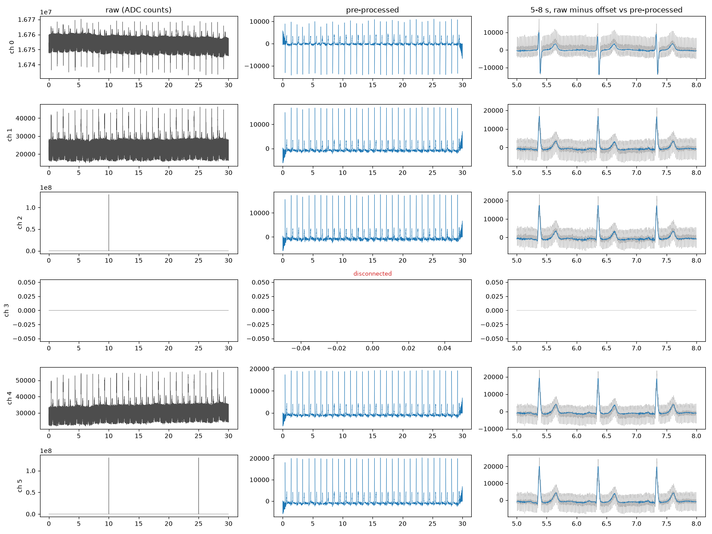
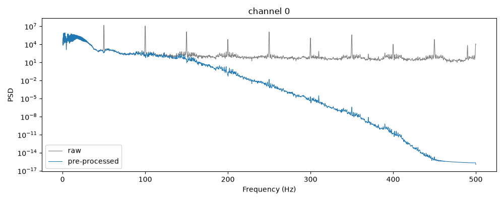

# ECG pre-processing

Pre-processing of multichannel ECG recordings in Python (NumPy and SciPy):

1. removal of recording spikes,
2. offset removal,
3. powerline interference filtering,
4. low-pass filtering,
5. baseline wander removal,

plus detection of channels that are not connected, and a test suite that checks
data types, the expected result of each step, the whole pipeline and the
computational time.

## Files

| File | Content |
|---|---|
| `preprocessing.py` | One function per step and `preprocess()`, which runs them in order |
| `lead_off.py` | `find_disconnected()` |
| `mat_io.py` | `load_ecg()` / `save_ecg()` for MATLAB files (v5 and v7.3) |
| `test_preprocessing.py` | 16 tests, run with `python -m pytest` |
| `run_example.py` | Processes `data/ecgConditioningExample.mat`, saves the result and two figures |

## Usage

```
pip install -r requirements.txt
python run_example.py
python -m pytest -s
```

```python
from mat_io import load_ecg
from preprocessing import preprocess

ecg, fs = load_ecg("data/ecgConditioningExample.mat")   # (n_channels, n_samples), Hz
result = preprocess(ecg, fs)
result.signals        # pre-processed, float64; disconnected channels are NaN
result.disconnected   # bool per channel
result.spike_mask     # bool per sample, True where a spike was replaced
result.powerline_hz   # mains frequency found in the data
```

`run_example.py` writes `ecg_preprocessed.mat` in the same orientation as the
input (`n_samples x n_channels`), so it opens in MATLAB directly.

## Result on the provided recording

6 channels, 30 s at 1 kHz, raw ADC counts. Processed in about 60 ms.

```
powerline frequency: 50 Hz
channel 0: ok
channel 1: ok
channel 2: ok, 8 samples replaced
channel 3: disconnected
channel 4: ok
channel 5: ok, 16 samples replaced
```

- Channel 3 is all zeros.
- Channels 2 and 5 have 4-sample spikes of 1.3e8 counts at 10.0 s (and 25.0 s for channel 5).
- Every channel carries strong 50 Hz interference with harmonics up to 450 Hz.
- Channel 0 sits at an offset of 1.675e7 counts, close to the 24-bit full scale, but it is a valid ECG. Disconnection is therefore not judged from the DC level.





## Steps and parameters

All filters are zero-phase (forward-backward, `sosfiltfilt`) so P, QRS and T
waves keep their timing, and are built as second-order sections, which stay
numerically stable at a cut-off of 0.5 Hz with fs = 1 kHz.

**Order.** Spikes are removed before any filtering: a filter would spread a
1e8-count spike into ringing hundreds of milliseconds long. The offset is
removed before the filters so that the edge padding does not start from a
large DC step. The three filters are linear, so their order among themselves
does not matter.

**Spikes.** A sample is a spike when its distance to a local baseline (median
of 0.5 s blocks) exceeds 5 times the 99th percentile of that distance. The
99th percentile sits near the top of the R waves, so normal beats are never
flagged, while spikes are orders of magnitude above it. A threshold based on
the noise level (k times the MAD) was not used because on a clean recording it
flags R waves. The gap, widened by 2 ms on each side, is filled with a copy of
the signal one mains period earlier: a straight line would cut a piece out of
the 50 Hz wave, and the notch filter would later turn that missing piece into
a bump.

**Offset.** Per-channel median, robust to any leftover artefact.

**Powerline.** The mains frequency is measured from the data (50 or 60 Hz,
whichever band holds more power) so the notches stay centred. A 1 Hz-wide IIR
notch is applied at the fundamental and at every harmonic below Nyquist: in
this recording the harmonics reach 450 Hz, 25 to 55 dB above the noise floor,
and the low-pass alone does not attenuate the ones just above its cut-off
enough. Constant width (not constant Q) keeps the high harmonics from getting
wider notches.

**Low-pass, 150 Hz, Butterworth order 4.** The AHA/ACCF/HRS recommendation
for diagnostic adult ECG bandwidth (Kligfield et al., Circulation 2007); it
keeps QRS notching and slurring. Use `lowpass_hz=40` for rhythm monitoring.

**Baseline wander, 0.5 Hz high-pass, Butterworth order 2.** Respiration and
motion wander lie below 0.5 Hz; the heart rate is above 0.67 Hz for rates over
40 bpm. The same recommendations accept cut-offs up to 0.67 Hz for zero-phase
filters, because the ST distortion of high-pass filters comes from the phase
response of causal filters.

**Disconnected channels.** Two symptoms, two checks:

| Symptom | Check |
|---|---|
| Flat line: zeros, a constant, stuck at an ADC rail | More than 90% of consecutive raw samples identical |
| Floating electrode: mains and noise, no heartbeat | Kurtosis of the filtered signal below 5 (noise is near 3, an ECG with its sharp QRS is 18 to 22 here; kSQI of Li, Mark and Clifford, 2008) |

Disconnected channels are returned as NaN so they cannot be used by mistake.

## Tests

`python -m pytest -s` runs 16 tests in about 2 s and prints the time of each
step.

| Group | Tests |
|---|---|
| Data types | Output is `float64` for `int16`, `int32` and `float32` input; 1-D and 2-D shapes are preserved; invalid input raises |
| Expected results | No false spikes on a clean ECG from 40 to 150 bpm; spikes removed exactly where placed; offset removed; notch gives more than 40 dB at 50, 100 and 150 Hz and less than 0.1 dB at 10 Hz; low-pass and high-pass responses; R peaks do not move |
| Disconnected channels | Zeros, a constant, Gaussian noise and a floating electrode are flagged; valid channels with different gain, offset and polarity are not |
| Whole pipeline | A synthetic ECG with mains, wander, offset and spikes comes back with correlation above 0.995 and error below 1% of range; on the provided file, channel 3 is the only one flagged, spikes are found at 10.0 s and 25.0 s, mains harmonics drop by more than 30 dB and the 2 to 40 Hz band changes by less than 0.5 dB |
| Computational time | The provided file processes in under 1 s; the time of each step is printed |

The synthetic ECG used by the tests (a sum of Gaussian waves per beat, after
McSharry et al., 2003) gives a known ground truth, which the real recording
cannot.

## Limitations

- Signals stay in ADC counts; conversion to mV needs the acquisition gain.
- Pacemaker spikes would be removed as recording spikes.
- The first and last second carry some filter edge effect; the tests exclude them.
- Channel 0 has inverted polarity relative to the others and is left as is.
